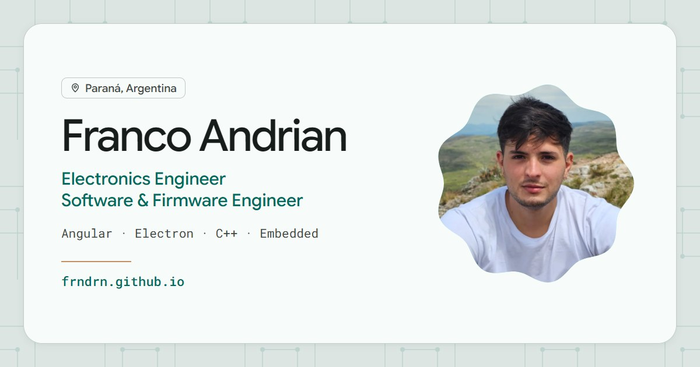

# Portfolio

My personal portfolio, in English and Spanish: **[frndrn.github.io](https://frndrn.github.io/)**



## Stack

- **Angular 22**: standalone components, signals for state and zoneless change detection (no `zone.js`).
- **Angular Material**, with light, dark and system themes.
- **Static prerendering**: every route is rendered to HTML at build time, so it runs on GitHub
  Pages and link previews show real content.
- **ESLint, Prettier and Vitest**, all run in CI before each deploy.

## How it's organised

```
src/app/
├── data/                 Content model and the Portfolio service
│   ├── content/          All the site's text, one file per section
│   │   └── projects/     One file per project
│   └── portfolio.ts      Serves the content to the UI
├── home/                 Home page sections
├── projects/             /projects page and its filters
├── layout/               App bar, bottom nav, footer
└── shared/               i18n, theme, icons and small UI pieces
```

I kept the content apart from the components. Every text is written once, with both languages
side by side:

```ts
role: t('Software & Firmware Engineer', 'Ingeniero de Software y Firmware'),
```

`t` picks the active language, and the `Portfolio` service exposes each section as a signal, so
switching language just recomputes the content. Components never import the content files
directly. UI labels (nav, buttons) live in `src/app/shared/i18n/ui-strings.ts`.

English is the default and the one that gets prerendered. If you pick Spanish, it's applied in
the browser after hydration and remembered for your next visit.

### Adding a project

1. Create `src/app/data/content/projects/<name>.ts` returning a `Project`
   (fields in `src/app/data/project.ts`).
2. Add it to `src/app/data/content/projects/index.ts`. That list sets the display order.
3. Put its image in `public/images/projects/`.

## Running it

Needs Node 24 (`.nvmrc`).

```bash
npm ci          # install
npm start       # dev server at http://localhost:4200
npm run lint
npm test
npm run build   # prerendered output in dist/portfolio/browser
```

Pushing to `main` lints, tests, builds and deploys to GitHub Pages
(`.github/workflows/deploy.yml`).
